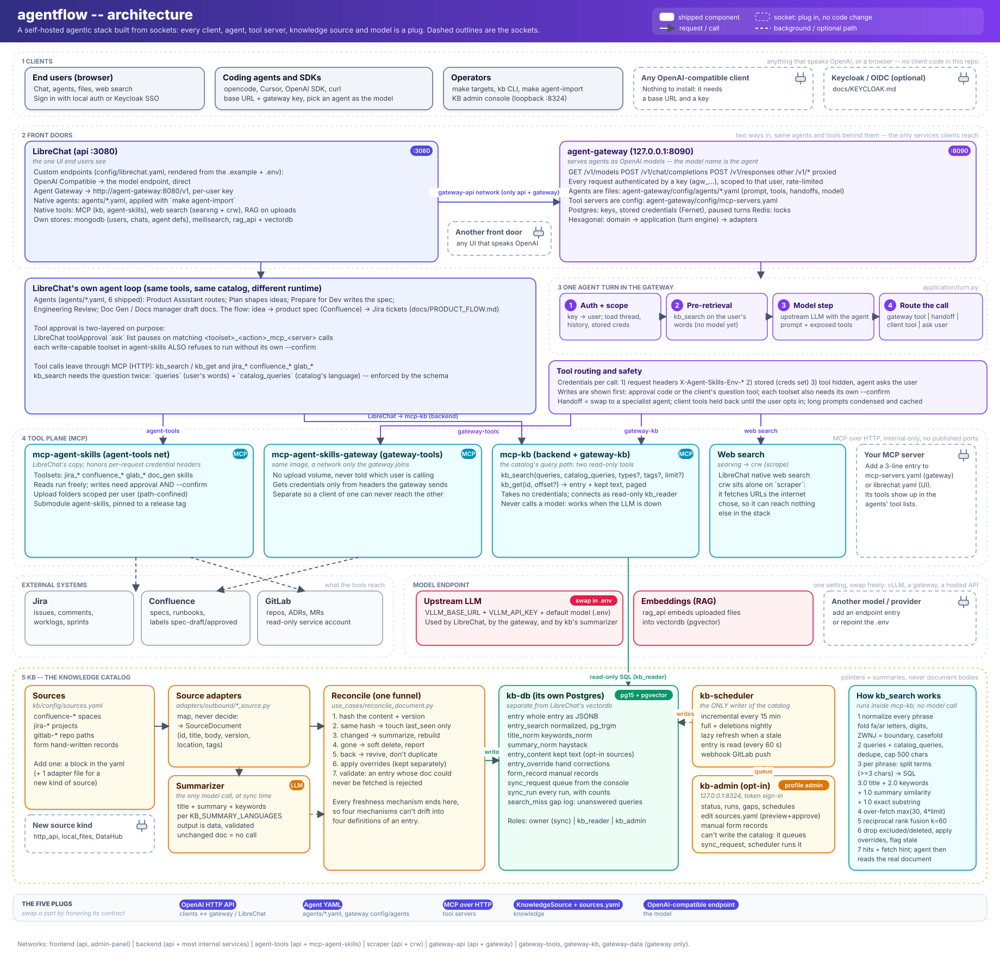
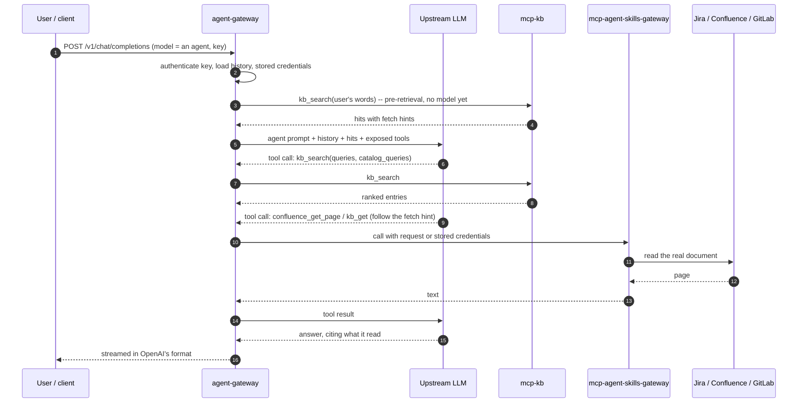
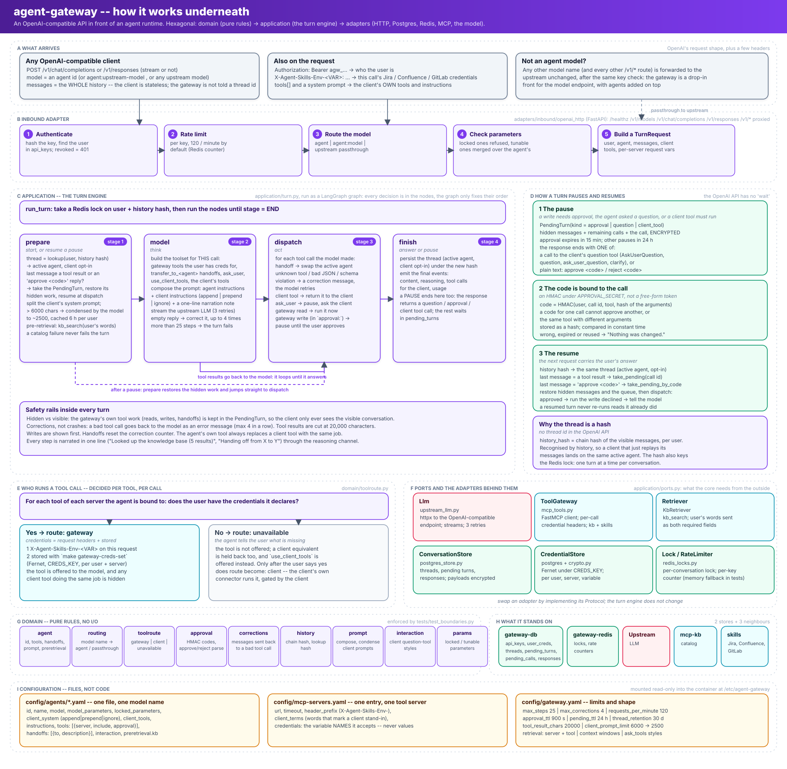

# Architecture

agentflow is a self-hosted agentic stack made of **sockets**. Users reach agents through
[LibreChat](https://www.librechat.ai/) or through `agent-gateway`, an OpenAI-compatible API. The
agents call tools over MCP, ground themselves in a knowledge catalog (`kb`), and think with
whatever OpenAI-compatible model endpoint you point the stack at. Every one of those pieces is
replaceable by honoring a small contract, so the stack changes by configuration, not by code.



> The diagram is generated; its source is a plain SVG, `docs/architecture.svg`. Dashed outlines are
> sockets: places where you plug something in without changing code.

Contents: [Stack at a glance](#stack-at-a-glance) | [Plug and play](#plug-and-play) |
[A request, end to end](#a-request-end-to-end) | [kb: the knowledge catalog](#kb-the-knowledge-catalog) |
[agent-gateway](#agent-gateway) | [Trust boundaries](#trust-boundaries) |
[Operating it](#operating-it) | [Limits and direction](#limits-and-direction)

## Stack at a glance

| Layer | Service | What it is | Reached by |
|---|---|---|---|
| Front door | `api` (LibreChat) | The UI end users see: chat, agents, files, web search | published `:3080` |
| Front door | `agent-gateway` | Serves agents as OpenAI models; every request needs a key | `127.0.0.1:8090`; LibreChat over `gateway-api` |
| Tools | `mcp-agent-skills` | Jira, Confluence, GitLab and document tools for LibreChat | `api` only (`agent-tools`) |
| Tools | `mcp-agent-skills-gateway` | The same image for the gateway, on a network only it joins | `agent-gateway` only (`gateway-tools`) |
| Tools | `mcp-kb` | The catalog's query path: `kb_search`, `kb_get` | `api` (`backend`), `agent-gateway` (`gateway-kb`) |
| Tools | `searxng` + `crw` | Web search, then page scraping | `api` only (`crw` is alone on `scraper`) |
| Knowledge | `kb-db`, `kb-scheduler`, `kb-admin` | The catalog's own Postgres, its only writer, an opt-in console | `kb-admin` on `127.0.0.1:8324` |
| Stores | `mongodb`, `meilisearch`, `rag_api` + `vectordb`, `redis` | LibreChat's data, search and file RAG | `api` only |
| Stores | `gateway-db`, `gateway-redis` | The gateway's keys, credentials, paused turns, locks | `agent-gateway` only |
| Model | any OpenAI-compatible endpoint | Set with `VLLM_BASE_URL` / `VLLM_API_KEY` in `.env` | everything that thinks |

`docker-compose.yml` is the source of truth for wiring. A module's services live in its own
`compose.yaml` (`kb/compose.yaml`), included from the root.

## Plug and play

Five contracts hold the stack together. Honor one and the part behind it can change.

| Socket | Contract | To plug something in |
|---|---|---|
| **A client** | OpenAI HTTP API (`/v1/models`, `/v1/chat/completions`, `/v1/responses`) | Point any client at `http://<gateway>/v1` with a key from `make gateway-key-create USER=...`; choose an agent as the model |
| **An agent** | A YAML file | Add `agents/<name>.yaml` and run `make agent-import` (LibreChat), or `agent-gateway/config/agents/<name>.yaml` (gateway). Prompt, model, tools and handoffs are all in the file |
| **A tool server** | MCP over HTTP | Add an entry to `agent-gateway/config/mcp-servers.yaml` (gateway) or the `mcpServers` block of `config/librechat.yaml.example` (LibreChat). Its tools appear in the agents' tool lists. Keep it on an internal network with no published port |
| **A knowledge source** | `KnowledgeSource` port + `kb/config/sources.yaml` | Add a block to `sources.yaml` for Confluence, Jira, GitLab or a hand-written record. A new *kind* of source is one adapter file implementing the port; nothing else changes |
| **The model** | An OpenAI-compatible endpoint | Change the `.env` values, or add an endpoint entry in `librechat.yaml.example`. The catalog's summarizer and the gateway use the same endpoint |

Two properties make this safe to extend:

- **Configuration is declarative.** Agents, sources and config templates are files in the repo; the
  database holds state derived from them. `make agent-export` / `make agent-import` round-trip the
  agents; `config/librechat.yaml` is generated and never edited by hand.
- **Modules own themselves.** A module is a directory carrying its own compose file, env file,
  `make` targets, scripts, docs and spec. Removing `kb/` removes the catalog; adding a module is
  three lines in the root (an `include:`, an env-file path, a `make` include).

## A request, end to end

Both front doors end in the same place: an agent running a loop of *think, call a tool, read the
result*. They differ in who owns the loop.



**Through LibreChat** the loop runs in LibreChat itself: it holds the agent definitions
(`agents/*.yaml`), calls `mcp-kb` and `mcp-agent-skills` directly, and asks the user before write
tools run. **Through the gateway** the loop runs in `agent-gateway` and any client can drive it.

The product flow the shipped agents implement (idea, then a product spec in Confluence, then Jira
tickets) is described in [`PRODUCT_FLOW.md`](PRODUCT_FLOW.md); each agent is in
[`docs/agents/`](agents/README.md).

## kb: the knowledge catalog

`kb` answers one question for an agent: **which document knows about this, and where does it
live?** It does not hold documents. An *entry* is a pointer plus a summary: title, summary,
keywords and tags per language, an owner, a type, and a **location** (what to call to read the real
thing). Specified in [`kb/docs/SPEC.md`](../kb/docs/SPEC.md); operated with
[`kb/docs/OPERATOR_GUIDE.md`](../kb/docs/OPERATOR_GUIDE.md).

### What it depends on

| Dependency | Used for | When |
|---|---|---|
| Postgres (`kb-db`, its own instance) | the catalog and the search index (`pg_trgm`) | always |
| The model endpoint | writing summaries and keywords | **sync time only** |
| Source APIs (Confluence, Jira, GitLab) and a read-only service account each | reading documents to catalog | sync time only |
| `kb-scheduler` | the only writer of the catalog | background |

The query path needs **only Postgres**. A search never calls a model and never touches the
network, so `kb_search` keeps working while the model endpoint or a wiki is down.

### How entries get in

```
source ──> source adapter ──> reconcile (the one funnel) ──> kb-db
 (yaml)     maps to            hash gate, summarize,          entry, entry_search,
            SourceDocument     soft delete, overrides         entry_content, ...
```

1. **Sources** are declared in `kb/config/sources.yaml` (a Confluence space, a Jira project, a
   GitLab path, or hand-written *form* records from the admin console). The file names *what* to
   catalog and which environment variable holds the credential; it never contains one.
2. **Adapters** map whatever the source returns into a `SourceDocument`. They map; they do not
   decide.
3. **Reconcile** is the single code path every freshness mechanism goes through:
   - same content hash: update `last_seen_at` only. No model call, no write.
   - changed: summarize with the model, rebuild the entry, keep the original `created_at`.
   - gone: soft delete and report; returned: revive, never duplicate.
   - then apply overrides (stored separately, re-applied after every sync).
   - an entry whose document could never be fetched is rejected on construction.
4. The **summarizer** writes title, summary and keywords in every language listed in
   `KB_SUMMARY_LANGUAGES`. Its output is parsed and validated as data and never followed as
   instructions.

Four mechanisms keep the catalog fresh, all feeding the same funnel:

| Mechanism | Cadence | What it catches |
|---|---|---|
| Incremental sync | every 15 min, per source | changes since a stored checkpoint |
| Lazy refresh | when a stale entry is read (drained every 60 s) | an entry past `stale_after` (24 h) |
| Webhook | on GitLab push (opt-in) | seconds-fresh updates for the paths pushed |
| Full reconciliation | nightly | deletions, moves, missed events |

`kb-scheduler` runs them and records every run. The admin console can request a sync, but it
cannot write the catalog (its database role is refused): it queues a `sync_request` and the
scheduler executes it. A hand-written *form record* reaches the catalog the same way, as a sync of
the built-in `form` source.

### How retrieval works

`kb_search` takes the question **twice**: `queries` (the user's own words) and `catalog_queries`
(the same question rewritten in the catalog's language). The second is required by the tool's
schema, because a question that reaches an English-only catalog in Persian matches nothing, and a
sentence in a tool description was not enough to make models translate. Both lists are searched
and fused.

```
queries + catalog_queries
   │  1. normalize each phrase, dedupe, cap at 500 chars
   ▼
per phrase
   │  2. split into terms (>= 3 characters; if none, match the phrase whole)
   │  3. score every indexable entry in SQL:
   │        3.0 x word_similarity(term, title)
   │      + 2.0 x word_similarity(term, keywords)
   │      + 1.0 x word_similarity(term, summary)
   │      + 1.0   if the term is an exact substring of the entry
   │     summed over the phrase's terms; filter by type / tag; ties broken by entry id
   │  4. keep the top max(30, 4 x limit) candidates
   ▼
   │  5. reciprocal rank fusion across phrases (k = 60, ties by first appearance)
   ▼
   │  6. drop excluded and soft-deleted entries (they must not use a result slot),
   │     apply overrides, flag stale entries instead of hiding them
   ▼
hits: entry, score, stale, and a `fetch` hint naming the tool that reads the real document
```

Notes that matter when reasoning about results:

- **Normalization** is applied identically when writing and when querying: Persian/Arabic letter
  variants and digits are folded, diacritics and tatweel dropped, a zero-width non-joiner is a word
  boundary, punctuation becomes a boundary, Latin text is case-folded.
- **Word similarity is trigram-based**, so it forgives typos and word forms but has no notion of
  meaning. "who runs engineering" will not find "CTO" unless those words are in the entry. That is
  why summaries carry keywords and synonyms, and why the catalog is written in the language the
  questions are rewritten into.
- **Fusion** needs no tuning and no comparable scores: an entry found by two phrasings outranks one
  found by either.
- **A miss is recorded** in the gap log (`search_miss`), shown in the admin console, so what people
  ask and do not find becomes a to-do list.
- **The summary is a pointer, not a source.** The agent is told to follow `fetch` and read the
  real document before answering. For sources marked `store_raw_content`, the catalog keeps the
  text and `fetch` names `kb_get`, which returns it page by page.

Two tools, both read-only and credential-free (the catalog is shared; there is nothing per-user to
supply): `kb_search(queries, catalog_queries, types?, tags?, limit?)` and `kb_get(id, offset?)`.

### Where it sits

`mcp-kb` is on `backend` (for LibreChat) and `gateway-kb` (for the gateway) and nowhere else; it
connects to `kb-db` as a read-only role. `kb-db` is its own Postgres, not another database in
LibreChat's `vectordb`, so restoring one can never touch the other. `kb-scheduler` holds the
source credentials and the owner role; `kb-admin` holds neither.

## agent-gateway

`agent-gateway` makes agents usable from anywhere that speaks the OpenAI API. Its model list is the
upstream models plus the agents; **the model name picks the agent**. Any other model name goes to
the upstream unchanged, and `model: "<agent>:<upstream-model>"` runs an agent on another model when
the agent allows it. Specified in [`agent-gateway/docs/spec.md`](../agent-gateway/docs/spec.md).

**API.** `GET /v1/models`, `POST /v1/chat/completions`, `POST /v1/responses`; everything else under
`/v1/` is proxied. Errors, usage and streaming use OpenAI's shapes. Models report their context
window.

**Auth and limits.** Identity is a Keycloak account (`sub`). A request carries a Keycloak access token
(the Telegram bot, the portal, automations), or, only with
`GATEWAY_ISSUE_KEYS`, a gateway-issued key, or the person's own registered model key when exactly one person
registered that string (`GATEWAY_MODEL_KEY_LOGIN`, read-only by default). The gateway resolves the caller to a person, their groups and
their roles, decides which agents they may use, and calls the model with their own key (there is no shared
fallback key). State (threads,
credentials, paused turns, audit) is scoped to the account id. Keycloak is the only place people, groups and
roles are managed; the gateway reads them from tokens and from a periodic read-only copy. See
[`KEYCLOAK.md`](KEYCLOAK.md) and [`specs/003-identity-access`](../specs/003-identity-access/spec.md). Rate
limit: 120 requests a minute per person by default (`agent-gateway/config/gateway.yaml`).

**One turn** (`application/turn.py`):

1. **Authenticate and load** the user's history and stored credentials.
2. **Pre-retrieve**: run `kb_search` on the user's words, before any model sees the turn. (There is
   no model here to translate, so the user's words are sent as both fields.)
3. **Model step**: the upstream LLM gets the agent's prompt, the history, the hits and the tools
   the agent may use.
4. **Route each tool call**: a gateway tool (run it), a handoff (swap to a specialist agent), a
   client tool (hand it back to the client, only after the user opts in), or a question for the
   user. A turn is capped at 25 model steps; consecutive model mistakes are tolerated up to a
   limit and then fail the turn.

**Credentials per tool call**, in order: headers on the request (`X-Agent-Skills-Env-<VAR>`), then
the user's stored credentials (`make gateway-creds-set`, encrypted at rest with `CREDS_KEY`), and
otherwise the tool is not offered and the agent says which credentials are missing. Request headers
are what a coding agent can send per call; the LibreChat connection cannot vary them per user, so
those users use stored credentials.

**Writes are shown first.** A write the gateway runs pauses the turn with an approval, shown through
the client's own question tool when it has one, otherwise as a code the user replies to
(`approve <code>`). Approvals expire after 15 minutes, a paused turn can be resumed for 24 hours,
and each toolset still needs its own `--confirm` underneath. The two layers are deliberate and
neither replaces the other.

**State.** Postgres holds keys, encrypted credentials and paused turns (retained 30 days);
Redis holds locks so one thread runs one turn at a time.

**Agents** are YAML in `agent-gateway/config/agents/`: id, name, model, parameters, instructions,
the tools it may use, the agents it may hand off to. Tool servers are YAML in
`config/mcp-servers.yaml` and list the credential variable *names* they accept, never values.

### Underneath



The gateway is hexagonal: `domain/` holds pure rules (agent definitions, routing, tool routing,
approval codes, corrections, history hashing), `application/` holds the turn engine, and
`adapters/` talks to the outside world (HTTP in; Postgres, Redis, MCP and the model out). A test
fails if `domain/` or `application/` import anything that does I/O, so an adapter can be swapped by
implementing its protocol in `application/ports.py`.

- **A request is a whole conversation.** The OpenAI API is stateless, so the client replays the
  full history every time. The gateway recognises a conversation by a chain hash of the visible
  messages (per user), which is how it remembers the active agent and whether the user opted in to
  their client's own tools. The same hash keys a Redis lock, so a conversation runs one turn at a
  time.
- **A turn is four nodes**, run by LangGraph but decided entirely in `application/turn.py`:
  `prepare` (restore state, condense a long client prompt, pre-retrieve from `kb`), `model` (build
  this call's toolset, call the upstream model), `dispatch` (route each tool call: handoff, client
  tool, question, gateway read, gateway write), and `finish`. Tool results loop back to `model`
  until it answers. A bad tool call (unknown tool, invalid JSON, schema violation) goes back to the
  model as an error message, up to 4 times in a row, instead of failing the turn.
- **A pause is a stored turn.** When a write needs approval, the agent asks a question, or a client
  tool must run, the gateway stores a `PendingTurn` (encrypted: the hidden work, the remaining
  calls, the call itself) and ends the response with the question. The approval code is an HMAC
  over the user, call id, tool and argument hash, so it approves exactly one call and nothing
  else. The next request carries the answer; `prepare` takes the pending turn, restores it and
  jumps straight to `dispatch`. Approvals expire after 15 minutes; other pauses after 24 hours.
- **Who runs a tool is decided per call.** If the user has the credentials a tool's server declares
  (request headers first, then stored), the gateway runs it and hides any client tool with the same
  job. If not, the tool is not offered, the agent says what is missing, and the client's own
  equivalent stays held back until the user opts in.

## Trust boundaries

Access control here is mostly **network reachability**, because MCP's HTTP transport has no auth of
its own. So each internal service sits on the smallest network that works:

| Network | Members | Why it exists |
|---|---|---|
| `frontend` | `api`, `admin-panel` | what a browser can reach |
| `backend` | `api` and most internal services | the shared internal network |
| `agent-tools` | `api`, `mcp-agent-skills` | that server trusts per-request credential headers, so nothing else may share it |
| `scraper` | `api`, `crw` | `crw` fetches URLs the internet chose, so it can reach nothing else |
| `gateway-api` | `api`, `agent-gateway` | LibreChat's only link to the gateway |
| `gateway-tools` | `agent-gateway`, `mcp-agent-skills-gateway` | the gateway's own tool server |
| `gateway-kb` | `agent-gateway`, `mcp-kb` | read access to the catalog without joining `backend` |
| `gateway-data` | `agent-gateway`, `gateway-db`, `gateway-redis` | the gateway's stores |

Identity adds one more trust edge: the gateway forwards a caller's group names to `mcp-kb` in `X-KB-Groups`,
and `mcp-kb` believes them only when the request also carries `X-KB-Trust` equal to `KB_TRUST_SECRET`
(held by the gateway and `mcp-kb` alone). The gateway reaches Keycloak over its public address, never through
`backend`. Keycloak is an external dependency of this stack (the `integrations/keycloak/` realm template
describes what the stack needs from it).

Rules that follow from this: only `api` and `agent-gateway` face users or clients; every other
service has no `ports:` entry; `agent-gateway` never joins `backend`; and secrets live in `.env`
files (gitignored), never in a tracked file. Credentials for Jira and friends are per user and
travel as headers or encrypted stored values, never in agent files.

## Operating it

```bash
make up                 # first run and every re-run: build, start, wait healthy, create admin
make ps                 # health of every service
make gateway-up         # start the gateway (make up also starts it when .env.agent-gateway exists)
make gateway-key-create USER=you@example.org
make agent-import       # apply agents/*.yaml to LibreChat (DRY_RUN=1 to preview)
make kb-status          # what the catalog contains
make kb-sync SOURCE=confluence-dat
make kb-admin-up        # the catalog's admin console on 127.0.0.1:8324
make backup             # snapshot every volume and the env files
```

Day-to-day, configuration lives in [`CONFIGURATION.md`](CONFIGURATION.md), backups and upgrades in
[`OPERATIONS.md`](OPERATIONS.md), and known failures in [`TROUBLESHOOTING.md`](TROUBLESHOOTING.md).

## Limits and direction

- **Search is lexical.** Trigram similarity over normalized titles, keywords and summaries. It
  finds what shares words (or near-words) with the query and is blind to meaning. Multilingual
  questions are bridged by writing the catalog in the questions' language and by the required
  `catalog_queries` rewrite; `KB_SUMMARY_LANGUAGES=en,fa` would catalog every entry in both.
- **No listing.** The agent can search and read; it cannot ask for "all entries from this source".
- **The gateway's pre-retrieval does not translate.** It runs before any model sees the turn.
- **Embeddings are the real long-term answer** for meaning-based and cross-language retrieval; the
  catalog already runs on a pgvector-capable Postgres and the stack's direction is to move the
  catalog onto a data-catalog platform, so this is decided there rather than bolted on here.
- **Two front doors, one set of agent files per runtime.** LibreChat agents (`agents/`) and gateway
  agents (`agent-gateway/config/agents/`) share ideas but not files; a prompt change has to be made
  in both.
