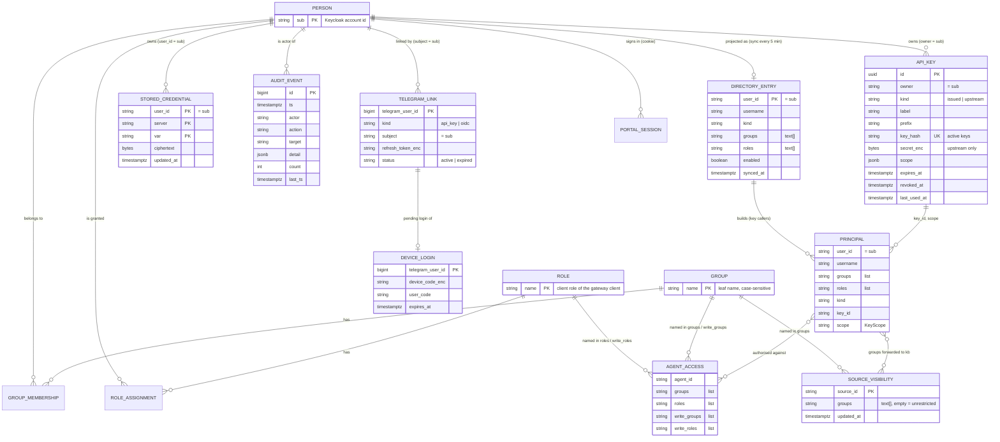

# Data model: Identity and access

Every entity, who owns it, and the rules that must always hold. Names in code blocks are the names
the code will use. "Owner" is the module that writes it. Nothing here is stored in the identity
provider except what it already stores (accounts, groups, roles). The gateway only **reads** groups
and roles; creating them and assigning them to people is done in the provider's own admin UI
(Keycloak), never through the gateway.

| Entity | Owner | Stored as | Section |
|---|---|---|---|
| Person | identity provider (Keycloak) | the account; projected as a `DirectoryEntry` | 1 |
| Group, Role | identity provider (Keycloak) | names; copied into the directory copy, tokens and config | 2 |
| Principal, KeyScope | gateway | in memory, per request | 3 |
| ApiKey | gateway | table `api_keys` | 4 |
| StoredCredential | gateway | table `user_credentials` | 5 |
| DirectoryEntry | gateway | table `directory_snapshot` | 6 |
| AuditEvent | gateway | table `audit_log` | 7 |
| PortalSession | gateway (portal) | a signed cookie, not stored | 8 |
| AgentAccess | gateway | YAML in an agent file | 9 |
| SourceVisibility | kb | table `source_visibility`, from `sources.yaml` | 10 |
| TelegramLink, DeviceLogin | bot | tables `links`, `device_logins` | 11 |

## Entity relationships



`GROUP_MEMBERSHIP`, `ROLE_ASSIGNMENT` and `PERSON` are the identity provider's. `PRINCIPAL` and `PORTAL_SESSION` are never stored.

---

## 1. Person

The human (or, for `kind=service`, the machine) as Keycloak knows them.

| Field | Type | Notes |
|---|---|---|
| `sub` | string (UUID text) | Keycloak account id. The only key used for ownership anywhere. |
| `username` | string | `preferred_username`. For display and audit; may change. Never a key. |
| `enabled` | bool | Keycloak's flag. |
| groups | set of Group | direct memberships only. |
| roles | set of Role | effective roles for the gateway, as the provider defines them (Keycloak: the client roles of the gateway's own client, including those inherited through groups and composites; realm roles are not used). |

**Invariants**

- `sub` never changes and is never reused by Keycloak. Every owner column in this change
  (`api_keys.owner`, `user_credentials.user_id`, `threads.user_id`, `audit_log.actor`,
  `links.subject`) holds a `sub`.
- A service account is a Keycloak user whose `username` starts with `service-account-`; it is
  `kind=service`.
- The gateway holds no other personal data: no email, no name, no attributes (FR-IDN-05).

**Lifecycle (in Keycloak)**: created by an administrator, then `enabled`; may be disabled (reversible),
or deleted (terminal). The gateway sees these only through tokens and the directory snapshot.

| Event in Keycloak | Seen by gateway | Effect |
|---|---|---|
| created | after next sync (or on-demand refresh) | key callers can be resolved |
| disabled | after next sync | all requests refused; refresh at Keycloak already fails |
| group added / removed | key callers: next sync. Token callers: next token | authorisation changes |
| deleted | after next sync (row removed) | keys stop working; stored data remains until purged |

## 2. Group and Role

A group or role name, as a string. Both are managed (created, assigned, removed) only in the identity
provider; the gateway reads them from tokens and from the directory copy.

**Role**: provider-neutral name. For Keycloak, the effective client roles of the gateway's own
client (`agent-gateway`), read from `resource_access.agent-gateway.roles` in tokens and from the
Admin API's effective client-role mappings in the directory sync, flattened to plain names. Realm
roles are cross-application in Keycloak's convention and are not used, so built-in roles never
appear. Same validity rules as groups. Recommended practice: assign client roles to groups.

**Invariants**

- Exact match, case-sensitive, no path (`full.path=false` in the realm mapper), no nesting inheritance.
- Valid when non-empty after strip, contains no comma and no control character, at most 128
  characters. Anything else is rejected where configured (agent files, sources) and dropped, with a
  log line, where received (token, directory, header).
- Groups and roles are not stored as their own tables anywhere. They appear as strings in
  `directory_snapshot.groups` and `.roles`, in agent files (`access`) and, for groups only, in
  `source_visibility.groups`.

## 3. Principal and KeyScope (gateway, domain)

```python
@dataclass(frozen=True)
class KeyScope:
    agents: tuple[str, ...] = ()   # () = all permitted agents
    write: bool = True

@dataclass(frozen=True)
class Principal:
    user_id: str                   # the sub
    username: str
    groups: tuple[str, ...] = ()
    roles: tuple[str, ...] = ()
    kind: Literal["user", "service"] = "user"
    key_id: str | None = None      # set when the bearer was a key
    scope: KeyScope = KeyScope()
```

| Field | Rule |
|---|---|
| `user_id` | non-empty; equals a Keycloak `sub`. |
| `username` | may be empty only for tests; real principals always have one (falls back to `sub`). |
| `groups`, `roles` | deduplicated, valid names; order irrelevant (compare as sets). |
| `kind` | `service` iff the account is a Keycloak service account. |
| `key_id` | `None` for token callers; the `api_keys.id` for key callers. |
| `scope` | token callers: default (all agents, write allowed). Key callers: the key's scope. A registered model key (`kind=upstream`) used as a bearer has the default scope. |

**Lifecycle**: built once per request at the front door by the authenticator; passed on the neutral
turn request; discarded when the request ends. Never written to a thread or a pending turn:
authorisation is evaluated again on resume (FR-ENT-09).

## 4. ApiKey (gateway: table `api_keys`)

Two kinds share one table because both are "a secret a caller can present, owned by a person".

| Column | Type | Notes |
|---|---|---|
| `id` | uuid PK | |
| `owner` | text, not null | the person's `sub`. |
| `kind` | text, `issued` or `upstream` | `issued`: a gateway `agk_` key (only under `GATEWAY_ISSUE_KEYS`). `upstream`: the person's own key for the model. |
| `label` | text | free text, may be empty. |
| `prefix` | text, not null | a fragment for recognising the key in a list: first 8 characters of an issued key (`agk_` plus 4), last 4 characters of an upstream key (never the first, which can identify the provider). Not a secret. |
| `key_hash` | text, not null | hex SHA-256 of the key. Unique among keys that are not revoked. |
| `secret_enc` | bytea | Fernet token (`CREDS_KEY`) of the key. Present exactly while an `upstream` key is active; always null for `issued`. |
| `scope` | jsonb | `{"agents": [...], "write": bool}` as `KeyScope`. Meaningful for `issued`; ignored for `upstream`. |
| `created_at` | timestamptz | |
| `expires_at` | timestamptz null | only `issued` keys expire. |
| `revoked_at` | timestamptz null | set by revoke or by replacement; terminal. |
| `last_used_at` | timestamptz null | updated at most once per minute per key. |

**Invariants**

1. At most one active (`revoked_at IS NULL`) `upstream` key per `owner`.
2. `key_hash` is unique among active `issued` keys only (partial unique index, migration 006). Several
   people may hold the same `upstream` key string; the bearer lookup returns every active match and a
   string held by two or more owners identifies nobody (FR-ATH-14). A revoked key's hash may be
   registered again.
3. `secret_enc` is null for every `issued` key and for every revoked `upstream` key (revocation
   destroys the stored secret). It is non-null for an active `upstream` key.
4. An `issued` key can only be created while `GATEWAY_ISSUE_KEYS` is true, and authenticates only
   while it is true.
5. The secret is never returned by any list or read. `upstream` secrets leave storage only to
   be sent to the model endpoint; an `issued` secret leaves only once, at creation.
6. Hash lookup filters on `revoked_at IS NULL AND (expires_at IS NULL OR expires_at > now())`.

**State**

```
              register (upstream) / issue
 (none) ───────────────────────────────────▶ active
                                              │  │
                          time passes         │  │ revoke (owner or operator),
                          (issued only)       │  │ or replaced by a new upstream key
                                              ▼  ▼
                                           expired   revoked  (terminal; secret wiped)
```

`expired` is derived from `expires_at`, not stored. There is no way back from `revoked`.

## 5. StoredCredential (gateway: table `user_credentials`)

A person's own value for one variable of one tool server (for example `agent-skills` /
`JIRA_PASSWORD`). Same shape as today; recreated empty by migration 005.

| Column | Type | Notes |
|---|---|---|
| `user_id` | text | the `sub`. |
| `server` | text | a server id from `config/mcp-servers.yaml`. |
| `var` | text | one of that server's declared credential names. |
| `ciphertext` | bytea | Fernet token. |
| `updated_at` | timestamptz | |
| PK | `(user_id, server, var)` | |

**Invariants**

- `(server, var)` must be declared in `config/mcp-servers.yaml` when written (FR-CRD-05, FR-CRD-08).
  A variable removed from the declaration later is ignored and listed as "unknown" by the operator
  commands.
- The model key is not a row here. It lives in `api_keys` (one copy, section 4). The portal and the
  `creds list` command present it as server `llm`, variable `API_KEY`, computed from `api_keys`.
- Values are never listed (FR-CRD-06); listing returns variable names only.
- Request-supplied values win over stored ones, per variable (FR-CRD-01, unchanged).

**Lifecycle**: set (insert or replace) → deleted (single variable, or all of an owner by purge).

## 6. DirectoryEntry (gateway: table `directory_snapshot`)

The gateway's copy of one Keycloak account, refreshed every `DIRECTORY_SYNC_SECONDS`.

| Column | Type | Notes |
|---|---|---|
| `user_id` | text PK | the `sub`. |
| `username` | text | |
| `kind` | text, `user` or `service` | derived from the username prefix at sync. |
| `groups` | text[] | valid group names only. |
| `roles` | text[] | valid role names only. |
| `enabled` | bool | |
| `synced_at` | timestamptz | the time of the sync that wrote this row. |

**Invariants**

- A sync replaces the table's content in one transaction: upsert every account the provider
  returned (`DirectorySource.fetch_all()`), delete every row it did not. A sync that fails at any point (including one page) changes nothing.
- Every row written by one sync carries the same `synced_at`.
- A row is **fresh** if `now - synced_at <= DIRECTORY_MAX_STALE_SECONDS`. A stale row is not used to
  authenticate a key caller (FR-ATH-06).
- Contains no email and no attributes.

**Lifecycle**: absent → present (first sync after account creation) → updated each sync → deleted
(first sync after account deletion). `enabled=false` rows are kept (so a token for a disabled person
can be refused, FR-ATH-07).

## 7. AuditEvent (gateway: table `audit_log`)

| Column | Type | Notes |
|---|---|---|
| `id` | bigserial PK | |
| `ts` | timestamptz | first occurrence. |
| `last_ts` | timestamptz | last occurrence; equals `ts` when `count = 1`. |
| `actor` | text | a `sub`, or `cli` (an operator command), `system` (sync, pruning), `anonymous` (no valid identity). |
| `action` | text | from the vocabulary below. |
| `target` | text | what was acted on (a key id, `server/VAR`, an agent id, a reason code); may be empty. |
| `detail` | jsonb | small, secret-free context. |
| `count` | integer | how many identical events were folded into this one. |

**Vocabulary** (closed; adding one is a spec change)

| Action | When | `target` | `detail` |
|---|---|---|---|
| `key.register` | model key registered or replaced | key id | `{label, prefix, replaced: id?}` |
| `key.issue` | issued key created | key id | `{label, prefix, scope, expires_at}` |
| `key.revoke` | key revoked | key id | `{by: "owner"/"operator"}` |
| `cred.set` | credential variable written | `server/VAR` | `{}` |
| `cred.delete` | credential variable deleted | `server/VAR` | `{}` |
| `cred.test` | portal test call | `server` | `{ok: bool}` |
| `auth.denied` | request refused | reason code | `{path, reason}` |
| `auth.first_use` | first token seen for a `(sub, client)` pair in 24 h | client id (`azp`) | `{}` |
| `directory.sync_failed` | first failure of a failure streak | `""` | `{error: short text}` |
| `directory.sync_recovered` | first success after failures | `""` | `{}` |
| `upstream.key_rejected` | provider refused a person's model key | key id | `{status}` |
| `owner.purge` | operator purged an owner's data | `sub` | `{counts}` |

Reason codes for `auth.denied`: `no_bearer`, `malformed`, `bad_signature`, `expired`, `bad_audience`,
`bad_issuer`, `bad_algorithm`, `unknown_key`, `key_revoked`, `key_expired`, `issuing_disabled`,
`unknown_person`, `person_disabled`, `directory_stale`.

**Invariants**

- Never contains a token, a key, a credential value or a password, in any field.
- `detail` is at most 2 KiB when serialised; longer is truncated.
- Rows are only inserted, except that a repeat of an identical `(actor, action, target)` within 60
  seconds updates `count` and `last_ts` of the earlier row; and rows older than
  `AUDIT_RETENTION_DAYS` are deleted by pruning.
- A mutation and its audit row are written in one transaction. Denial events are best effort: a
  failure to write one never turns a refusal into an error.

## 8. PortalSession (gateway: a signed cookie)

Not stored. Two cookies:

**`portal_session`** (the signed-in state)

| Field | Notes |
|---|---|
| `v` | format version, 1. |
| `sub`, `username` | from the verified ID token. |
| `csrf` | random 32 bytes, base64url; a per-session token that forms must echo. |
| `iat`, `exp`, `seen` | issue time, absolute expiry (8 h), last-seen time. |

Wire form: `base64url(json) + "." + base64url(HMAC-SHA256(key, json))` with
`key = SHA-256("portal-session:" + PORTAL_SESSION_SECRET)`. Attributes: `HttpOnly`, `Secure`
(waived only for an `http://localhost` base URL), `SameSite=Lax`, `Path=/portal`.

**`portal_login`** (while signing in, 10 minutes): signed `{state, nonce, code_verifier, next}`.
Deleted on callback.

**Invariants**: a session is valid only while `now < exp` and `now - seen < 30 min`; `seen` is
refreshed (the cookie reissued) when older than 5 minutes; and at every request the person must be
enabled in a fresh directory row (FR-PRT-04). Changing `PORTAL_SESSION_SECRET` ends all sessions.

## 9. AgentAccess (gateway: YAML in an agent file)

```yaml
access:
  groups: [product, engineering]      # who may use the agent ...
  roles: [agent-user]                 # ... by group OR by role; absent block = every signed-in person
  write_groups: [leads]               # who may use its approval-gated write tools ...
  write_roles: [agent-writer]         # ... by group OR by role; none of the two = anyone who may use the agent
```

**Invariants**: `groups`, `roles`, `write_groups` and `write_roles`, when present, are non-empty lists
of valid names without duplicates; unknown keys are rejected (FR-AGT-01). An `access` block with
none of the four keys is rejected as ambiguous. A write list naming a group or role that the use
lists do not cover is allowed but reported by `check` as a warning (those people cannot reach the
agent). No hierarchy: the write rule is checked on its own.

Matching is **any-of**: a caller matches a rule when at least one of its groups is in the rule's
groups list **or** at least one of its roles is in the rule's roles list. If only one of the two
lists is given, only that one is consulted.

Decision table (principal P, agent A, key scope S):

| Question | Allowed when |
|---|---|
| Is A listed to P, and may P call it? | `A.access` absent, or `A.groups`/`A.roles` both absent, or P.groups ∩ A.groups ≠ ∅ or P.roles ∩ A.roles ≠ ∅; and (S.agents empty or A.id ∈ S.agents) |
| Is an approval-gated tool offered to P on A? | the row above, and (neither `A.write_groups` nor `A.write_roles` present, or P.groups ∩ A.write_groups ≠ ∅ or P.roles ∩ A.write_roles ≠ ∅), and S.write |
| May A hand off to B for P? | B listed to P by the first row |

## 10. SourceVisibility (kb: table `source_visibility`)

The groups allowed to see one source's entries. Written by the scheduler from
`kb/config/sources.yaml`; read by the query path.

| Column | Type | Notes |
|---|---|---|
| `source_id` | text PK | the source's id (the same value as `entry.source_id`). |
| `groups` | text[] | empty = unrestricted (visible to every caller, including callers with no group information). |
| `updated_at` | timestamptz | |

**Invariants**

- The scheduler upserts a source's row at the start of every run that touches the source, before
  writing any of its entries, and when a configuration change is applied (FR-VIS-03).
- An entry is visible to a caller iff a row exists for its source and (`groups` is empty or
  `groups && caller_groups`). **No row means not visible** (fail closed, FR-VIS-04).
- Migration 005 creates a row with empty groups for every source that already has entries, so
  nothing changes for existing deployments until an operator adds `groups`.
- A row survives removal of the source from the configuration for as long as the source has live
  entries (so retiring entries is a separate, visible step); the row is deleted when none remain.
- Group names follow section 2. Visibility is by **groups only**; roles do not apply to sources
  (reason in `research.md`, D14).

**Lifecycle**: created (first run of a new source, or migration backfill) → updated (configuration
change) → deleted (source gone and entries retired).

## 11. TelegramLink and DeviceLogin (bot: tables `links`, `device_logins`)

`links` already exists (pairing). A row is one Telegram account tied to one way of calling the
endpoint.

| Column | Type | Notes |
|---|---|---|
| `telegram_user_id` | bigint PK | |
| `kind` | text, `api_key` or `oidc` | new. `api_key`: pairing mode, as today. `oidc`: device sign-in. |
| `username` | text | pairing: the claimed name. oidc: the issuer's `preferred_username`, else the Telegram name. |
| `telegram_name` | text | |
| `api_key_enc` | text null | encrypted key; `api_key` links only. |
| `subject` | text null | the issuer's `sub`; `oidc` links only. Not unique: a person may link several Telegram accounts. |
| `refresh_token_enc` | text null | encrypted (`CREDS_KEY`); `oidc` links only; cleared when the link expires. |
| `status` | text, `active` or `expired` | `expired` after the issuer refused a refresh. |
| `refreshed_at` | timestamptz null | last successful refresh. |
| `created_at` | timestamptz | |

`device_logins` holds a login in progress, so it survives a restart.

| Column | Type | Notes |
|---|---|---|
| `telegram_user_id` | bigint PK | one pending login per user; starting another replaces it. |
| `chat_id` | bigint | where to report the result (always a private chat). |
| `username`, `telegram_name` | text | for the resulting link. |
| `device_code_enc` | text | encrypted device code. |
| `user_code`, `verification_uri`, `verification_uri_complete` | text | what the user saw. |
| `interval_seconds` | integer | polling interval, raised by `slow_down`. |
| `expires_at` | timestamptz | the issuer's expiry. |

**Invariants**: an `oidc` link has `subject` and no `api_key_enc`; an `api_key` link the reverse
(database check). A message from a user whose link is `expired` or absent never reaches the endpoint
(FR-LNK-01). Refresh tokens and device codes never appear in logs, replies or errors (FR-LNK-05).

**State**

```
                /login                    approved               refresh refused
 (no link) ─────────────▶ DeviceLogin ─────────────▶ link:active ─────────────▶ link:expired
      ▲                       │ expired / denied          │  │                        │
      │                       ▼                           │  │ /login                 │ /login
      │                    (deleted)                      │  └──── replaces ──────────┘
      └──────────────────────── /logout (revoke at issuer, delete) ───────────────┘
```

---

## SQL

### Gateway: `agent-gateway/migrations/005_identity.sql`

The gateway applies each migration file once (`schema_migrations`), so the destructive part runs
exactly once.

```sql
-- Identity and access (specs/003-identity-access).
--
-- Ownership moves from free-text user ids to the identity provider's account id (`sub`). Rows
-- written under the old ids cannot be mapped, so they are discarded and people register again
-- (FR-IDN-07). Nothing here preserves them on purpose.
TRUNCATE pending_calls, pending_turns, threads, responses;
DROP TABLE IF EXISTS api_keys;
DROP TABLE IF EXISTS user_credentials;

-- A secret a caller can present, owned by a person.
--   issued   an `agk_` key minted by the gateway (only while GATEWAY_ISSUE_KEYS is on)
--   upstream the person's own key for the model; stored reversibly because the gateway must
--            send it, plus a one-way hash used to recognise it as a bearer
CREATE TABLE api_keys (
    id           uuid PRIMARY KEY DEFAULT gen_random_uuid(),
    owner        text NOT NULL,
    kind         text NOT NULL CHECK (kind IN ('issued', 'upstream')),
    label        text NOT NULL DEFAULT '',
    prefix       text NOT NULL,
    key_hash     text NOT NULL,
    secret_enc   bytea,
    scope        jsonb NOT NULL DEFAULT '{"agents": [], "write": true}',
    created_at   timestamptz NOT NULL DEFAULT now(),
    expires_at   timestamptz,
    revoked_at   timestamptz,
    last_used_at timestamptz,
    CHECK (
        (kind = 'issued' AND secret_enc IS NULL)
        OR (kind = 'upstream' AND expires_at IS NULL
            AND ((revoked_at IS NULL AND secret_enc IS NOT NULL)
              OR (revoked_at IS NOT NULL AND secret_enc IS NULL)))
    )
);
CREATE INDEX api_keys_owner ON api_keys (owner);
CREATE UNIQUE INDEX api_keys_active_hash ON api_keys (key_hash) WHERE revoked_at IS NULL AND kind = 'issued';   -- 006
CREATE INDEX api_keys_active_lookup ON api_keys (key_hash) WHERE revoked_at IS NULL;                            -- 006
CREATE UNIQUE INDEX api_keys_one_active_upstream ON api_keys (owner)
    WHERE kind = 'upstream' AND revoked_at IS NULL;

-- A person's own value for one variable of one tool server. Same shape as before; `user_id` now
-- holds the account id.
CREATE TABLE user_credentials (
    user_id     text NOT NULL,
    server      text NOT NULL,
    var         text NOT NULL,
    ciphertext  bytea NOT NULL,
    updated_at  timestamptz NOT NULL DEFAULT now(),
    PRIMARY KEY (user_id, server, var)
);

-- The gateway's copy of the identity provider's user list (FR-IDN-03).
CREATE TABLE directory_snapshot (
    user_id    text PRIMARY KEY,
    username   text NOT NULL,
    kind       text NOT NULL DEFAULT 'user' CHECK (kind IN ('user', 'service')),
    groups     text[] NOT NULL DEFAULT '{}',
    roles      text[] NOT NULL DEFAULT '{}',
    enabled    boolean NOT NULL,
    synced_at  timestamptz NOT NULL
);
CREATE INDEX directory_snapshot_username ON directory_snapshot (username);

-- What happened (FR-AUD-01). Secret-free by construction (FR-AUD-03).
CREATE TABLE audit_log (
    id        bigserial PRIMARY KEY,
    ts        timestamptz NOT NULL DEFAULT now(),
    last_ts   timestamptz NOT NULL DEFAULT now(),
    actor     text NOT NULL,
    action    text NOT NULL,
    target    text NOT NULL DEFAULT '',
    detail    jsonb NOT NULL DEFAULT '{}',
    count     integer NOT NULL DEFAULT 1 CHECK (count >= 1)
);
CREATE INDEX audit_log_ts ON audit_log (ts DESC);
CREATE INDEX audit_log_actor ON audit_log (actor, ts DESC);
CREATE INDEX audit_log_action ON audit_log (action, ts DESC);
```

Migration `006` is reserved for a follow-up and is not used by this change.

### Knowledge base: `kb/migrations/005_source_visibility.sql`

```sql
-- Per-source group visibility (specs/003-identity-access, FR-VIS-*).
--
-- Written by the scheduler from `sources.yaml`, read by the query path. Empty `groups` means the
-- source is visible to everyone, including callers that supply no group information. A source with
-- no row here is visible to nobody (fail closed).

CREATE TABLE IF NOT EXISTS source_visibility (
    source_id  TEXT PRIMARY KEY,
    groups     TEXT[] NOT NULL DEFAULT '{}',
    updated_at TIMESTAMPTZ NOT NULL DEFAULT now()
);

-- Existing sources keep behaving as they do today: unrestricted until an operator adds groups.
INSERT INTO source_visibility (source_id)
SELECT DISTINCT source_id FROM entry
ON CONFLICT (source_id) DO NOTHING;

DO $$
BEGIN
    IF EXISTS (SELECT 1 FROM pg_roles WHERE rolname = 'kb_reader') THEN
        EXECUTE 'GRANT SELECT ON source_visibility TO kb_reader';
    END IF;
    IF EXISTS (SELECT 1 FROM pg_roles WHERE rolname = 'kb_admin') THEN
        EXECUTE 'GRANT SELECT ON source_visibility TO kb_admin';
    END IF;
END $$;
```

The visibility predicate every read applies (bound parameter `:groups` is the caller's group array,
empty when unknown):

```sql
EXISTS (SELECT 1 FROM source_visibility v
        WHERE v.source_id = e.source_id
          AND (cardinality(v.groups) = 0 OR v.groups && :groups))
```

### Telegram bot: `telegram-bot-gateway/migrations/002_oidc_links.sql`

```sql
-- Link a Telegram account through an OpenID Connect device sign-in.
--
-- A link is either an API key (pairing, as before) or a refresh token for an identity provider
-- (device sign-in). The bot never stores a password.
ALTER TABLE links ALTER COLUMN api_key_enc DROP NOT NULL;
ALTER TABLE links ADD COLUMN kind              text NOT NULL DEFAULT 'api_key'
    CHECK (kind IN ('api_key', 'oidc'));
ALTER TABLE links ADD COLUMN subject           text;
ALTER TABLE links ADD COLUMN refresh_token_enc text;
ALTER TABLE links ADD COLUMN status            text NOT NULL DEFAULT 'active'
    CHECK (status IN ('active', 'expired'));
ALTER TABLE links ADD COLUMN refreshed_at      timestamptz;
ALTER TABLE links ADD CONSTRAINT links_kind_shape CHECK (
    (kind = 'api_key' AND api_key_enc IS NOT NULL AND subject IS NULL AND refresh_token_enc IS NULL)
    OR (kind = 'oidc' AND api_key_enc IS NULL AND subject IS NOT NULL)
);
CREATE INDEX links_subject ON links (subject) WHERE subject IS NOT NULL;

-- A sign-in in progress, so it survives a restart.
CREATE TABLE device_logins (
    telegram_user_id          bigint PRIMARY KEY,
    chat_id                   bigint NOT NULL,
    username                  text NOT NULL,
    telegram_name             text NOT NULL,
    device_code_enc           text NOT NULL,
    user_code                 text NOT NULL,
    verification_uri          text NOT NULL,
    verification_uri_complete text,
    interval_seconds          integer NOT NULL DEFAULT 5,
    expires_at                timestamptz NOT NULL,
    created_at                timestamptz NOT NULL DEFAULT now()
);
```
